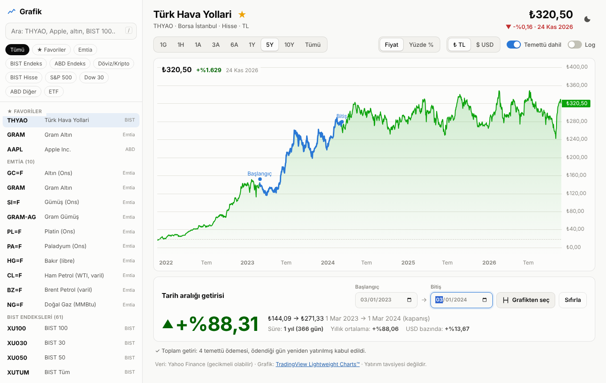

# Grafik

ABD ve Borsa İstanbul hisseleri, endeksler, altın, gümüş ve diğer emtialar için
**toplam getiri (temettü düzeltmeli)** grafik uygulaması. Fiyatlar tek tıkla **TL ↔ USD**
çevrilir, iki tarih arasındaki getiri büyük ve net bir şekilde gösterilir.



## Neler var?

- **~1.250 hazır enstrüman**, sol menüde gruplar halinde:
  - **BIST**: 596 hisse + 61 endeks (BIST 100, 30, 50, Banka, Sınai, Katılım, Temettü 25…)
  - **ABD**: S&P 500'ün tamamı (503 hisse), Dow Jones 30, popüler diğer hisseler (ASML, TSM, Shopify…),
    24 endeks (S&P 500, Nasdaq, Dow, Russell, SOX, VIX ve **toplam getiri** versiyonları), 26 ETF
  - **Emtia**: Altın, **Gram Altın**, Gümüş, Gram Gümüş, Platin, Paladyum, Bakır, Petrol (WTI/Brent), Doğal Gaz
  - **Döviz & Kripto**: USD/TRY, EUR/TRY, GBP/TRY, EUR/USD, Dolar Endeksi, Bitcoin, Ethereum
  - Listede olmayan her şey arama kutusundan bulunur (Yahoo Finance'teki tüm semboller)
- **Dönemler**: 1G · 1H · 1A · 3A · 6A · 1Y · 5Y · 10Y · Tümü
- **Fiyat** veya **yüzde %** gösterimi; uzun dönemler için **logaritmik** ölçek
- **TL / USD** dönüşümü: her gün, o günün USD/TRY kuruyla çevrilir
  (ör. bir BIST hissesinin dolar bazında gerçek getirisi)
- **Temettü dahil (toplam getiri)**: hisse ve ETF grafikleri varsayılan olarak temettüler
  yeniden yatırılmış gibi gösterilir; anahtarla sadece fiyata dönebilirsiniz
- **Tarih aralığı getirisi**: başlangıç ve bitiş tarihi girin (veya *Grafikten seç* ile
  grafikte iki noktaya tıklayın) — ne kadar artmış/düşmüş büyük yazıyla görünür.
  Yanında süre, yıllık ortalama getiri, diğer para birimindeki getiri ve temettüsüz getiri de yazar.
- Favoriler (☆), açık/koyu tema, telefona uyumlu arayüz, paylaşılabilir bağlantı (`#s=THYAO.IS&r=5Y`)

## Kurulum ve çalıştırma

Tek gereksinim **[Node.js](https://nodejs.org) 18 veya üstü** (LTS sürümünü kurmanız yeterli).
Başka hiçbir paket kurulmaz, internet bağlantısı veriyi çekmek için gereklidir.

1. Bu projeyi indirin: GitHub'da **Code → Download ZIP**, sonra zip'i bir klasöre açın.
2. Başlatın:
   - **Windows**: `baslat.bat` dosyasına çift tıklayın.
   - **macOS**: `baslat.command` dosyasına çift tıklayın (ilk seferde *sağ tık → Aç* gerekebilir).
   - **Terminal** (her sistem): klasörde `npm start` (ya da `node server.js --open`).
3. Tarayıcı kendiliğinden açılır: <http://localhost:3000>.
   Açık kalan siyah pencere uygulamanın kendisidir; kapatınca uygulama da kapanır.

### Telefondan kullanmak

Bilgisayar ve telefon aynı Wi-Fi ağındaysa uygulamayı şöyle başlatın:

```bash
HOST=0.0.0.0 node server.js           # macOS / Linux
set HOST=0.0.0.0 && node server.js    # Windows (cmd)
```

Sonra telefondan `http://<bilgisayarın-IP-adresi>:3000` adresini açın. Port için `PORT=8080` gibi
bir değişken de verebilirsiniz.

## Hesaplamalar nasıl yapılıyor?

**Toplam getiri (temettü düzeltmesi).** Her temettü için, temettünün hak kullanım (ex-date)
gününden önceki tüm kapanışlar `1 − temettü / önceki kapanış` ile çarpılır. Bu, temettünün
alındığı gün aynı hisseye yeniden yatırıldığı varsayımıyla elde edilen getiriye eşittir
(Yahoo'nun *Adj Close* değeriyle birebir aynı yöntem; birim testlerle doğrulanır).
Bölünmeler ve bedelsiz sermaye artırımları fiyatlara zaten yansıtılmıştır.

**TL ↔ USD.** Her günün fiyatı, aynı günün (yoksa önceki son günün) USD/TRY kapanış kuruyla
çevrilir. Gün içi grafiklerde gün içi kur kullanılır. USD/TRY verisi 3 Ocak 2005'ten başladığı için
daha eski fiyatlar çevrilmiş para biriminde gösterilemez (uygulama bunu not olarak belirtir).

**Tarih aralığı.** Başlangıç için o tarihteki ya da (tatil/hafta sonuysa) ondan önceki son
**kapanış**, bitiş için o tarihteki ya da önceki son kapanış alınır; kullanılan tarihler sonuçta yazar.
1G görünümünde baz, bir önceki günün kapanışıdır.

**Veri temizliği.** Yahoo verisindeki bilinen hatalar otomatik düzeltilir ve not olarak gösterilir:
- Bir günde 20 kattan fazla sıçrama (ör. bazı BIST hisselerinde 2005'teki 6 sıfır atılmasının
  düzeltilmemiş olması) önceki fiyatlar ölçeklenerek giderilir.
- Kapanış fiyatının yarısından büyük, bozuk görünen temettü kayıtları hesaba katılmaz.

### Bilinmesi gerekenler

- Veriler **Yahoo Finance**'ten gelir; borsalarda ~15 dakikaya kadar gecikmeli olabilir.
- **Endeksler fiyat endeksidir** (temettü içermez). S&P 500, Nasdaq 100, Dow, Russell 2000 ve
  S&P 600 için listede ayrıca *Toplam Getiri (TR)* versiyonları vardır; uygulama bunlara bağlantı verir.
- **Altın/gümüş** fiyatları COMEX vadeli kontratlarıdır (spot fiyata çok yakındır).
  **Gram altın** = ons fiyatı ÷ 31,1035.
- BIST'te **bedelli sermaye artırımları** Yahoo verisinde düzeltilmeyebilir; böyle bir günde
  grafikte gerçek olmayan bir düşüş görülebilir.
- Yatırım tavsiyesi değildir.

## Geliştirme

```bash
npm test          # birim testleri (hesaplamalar + sunucu)
npm run catalog   # sembol listesini Yahoo'ya karşı yeniden doğrulayıp public/data/catalog.json'u üretir
```

Yeni halka arzları eklemek için `scripts/build-catalog.mjs` içindeki listeye sembolü ekleyip
`npm run catalog` çalıştırın.

```
server.js                 Yerel web sunucusu (bağımlılıksız Node.js)
lib/yahoo.js              Yahoo Finance istemcisi + önbellek
public/index.html         Arayüz
public/style.css          Açık / koyu tema
public/js/app.js          Uygulama mantığı (liste, dönemler, ölçüm, notlar)
public/js/calc.js         Saf hesaplamalar: temettü düzeltmesi, veri temizliği, kur, aralık getirisi
public/js/chart.js        Grafik katmanı (TradingView Lightweight Charts v4)
public/js/format.js       Türkçe sayı/tarih biçimleri
public/data/catalog.json  Hazır sembol listesi
scripts/build-catalog.mjs Sembol listesini üretir
test/                     node:test birim testleri
```

Grafik kütüphanesi: [TradingView Lightweight Charts™](https://www.tradingview.com/lightweight-charts/)
(Apache 2.0, `public/vendor/` içinde).
